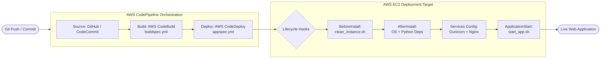
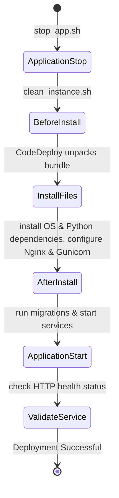

# AWS CI/CD Pipeline Blueprint: CodePipeline, CodeBuild & CodeDeploy

A production-ready reference kit and configuration repository for automating deployments to **AWS EC2** using **AWS CodePipeline**, **AWS CodeBuild**, **AWS CodeDeploy**, **Gunicorn**, and **Nginx**.

[](https://github.com/codewithmuh/ci-cd-configurations-files/releases)
[](https://github.com/codewithmuh/ci-cd-configurations-files/stargazers)
[](https://github.com/codewithmuh/ci-cd-configurations-files/network/members)
[](LICENSE)
[](https://aws.amazon.com)
[](https://youtube.com/@codewithmuh)
[](https://www.linkedin.com/in/muhammadrashid-daha/)

📺 **Full Walkthrough Video:** https://youtu.be/pXNB8uAGlx8

---

## 📑 Table of Contents
- [Architecture & Pipeline Flow](#architecture--pipeline-flow)
- [Repository File Catalog](#repository-file-catalog)
- [CodeDeploy Lifecycle Hooks Explained](#codedeploy-lifecycle-hooks)
- [Step-by-Step EC2 Setup Guide](#step-by-step-ec2-setup)
- [CodeBuild & CodeDeploy Configuration](#codebuild--codedeploy-configuration)
- [Author & Community](#author)
- [License](#license)

---

## 🏛️ Architecture & Pipeline Flow



---

## 📂 Repository File Catalog

| File / Folder | Role | Purpose |
| :--- | :--- | :--- |
| `buildspec.yml` | AWS CodeBuild Specification | Declares build phases, dependency installation, and artifact outputs for CodePipeline. |
| `appspec.yml` | AWS CodeDeploy Specification | Declares destination folder (`/home/ubuntu/blogprojectdrf`) and maps deployment lifecycle hooks to bash scripts. |
| `scripts/clean_instance.sh` | BeforeInstall Hook | Cleans up previous deployment build files to ensure a fresh runtime state. |
| `scripts/instance_os_dependencies.sh`| AfterInstall Hook | Installs required Linux system packages (Python, PIP, virtualenv, build-essentials). |
| `scripts/python_dependencies.sh` | AfterInstall Hook | Sets up Python virtual environment and installs project dependencies from `requirements.txt`. |
| `scripts/gunicorn.sh` | AfterInstall Hook | Configures Gunicorn systemd service and socket units. |
| `scripts/nginx.sh` | AfterInstall Hook | Configures Nginx reverse proxy routing requests to the Gunicorn socket. |
| `scripts/start_app.sh` | ApplicationStart Hook | Applies database migrations, collects static assets, and starts the systemd services. |
| `scripts/stop_app.sh` | ApplicationStop Hook | Gracefully shuts down active application workers before new code extraction. |
| `gunicorn/` | Service Configurations | Production-grade `gunicorn.service` and `gunicorn.socket` templates. |
| `nginx/` | Web Server Configurations | Nginx site block with optimized proxy headers and static asset handling. |

---

## ⚡ CodeDeploy Lifecycle Hooks

When AWS CodeDeploy initiates an EC2 deployment, scripts run in this exact order:



---

## 🛠️ Step-by-Step EC2 Setup

### 1. Install AWS CodeDeploy Agent on Ubuntu Server

Connect to your EC2 instance via SSH and run:

```bash
# Update package lists
sudo apt update -y
sudo apt install -y ruby-full wget

# Download the CodeDeploy agent for your AWS region (e.g. us-east-1)
cd /tmp
wget https://aws-codedeploy-us-east-1.s3.us-east-1.amazonaws.com/latest/install
chmod +x ./install

# Run installer and log output
sudo ./install auto > /tmp/logfile

# Verify agent status
sudo service codedeploy-agent status
```

*Note: Ensure your EC2 instance has an IAM Role attached with the `AWSCodeDeployFullAccess` policy.*

### 2. Verify System Service
If the agent is not running, start and enable it:

```bash
sudo service codedeploy-agent start
sudo systemctl enable codedeploy-agent
```

---

## ⚙️ CodeBuild & CodeDeploy Configuration

1. **AWS CodeBuild**: In your project's CodeBuild settings, select Ubuntu with Python runtime. The build will automatically ingest `buildspec.yml` from the root directory.
2. **AWS CodeDeploy**:
   - Create an Application in CodeDeploy (Compute platform: **EC2/On-premises**).
   - Create a Deployment Group targeting your EC2 instance tags (e.g., `Environment: Production`).
   - Select service role with `AWSCodeDeployRole`.
3. **AWS CodePipeline**: Connect your source repo, set CodeBuild as the build stage, and CodeDeploy as the deployment stage.

---

## 👨‍💻 Author

**Muhammad Rashid** — DevOps & Cloud Engineer, AWS Community Builder.
- 🎥 **YouTube:** [@codewithmuh](https://youtube.com/@codewithmuh)
- 💼 **LinkedIn:** [Muhammad Rashid](https://www.linkedin.com/in/muhammadrashid-daha/)
- 🌐 **Website:** [codewithmuh.com](https://codewithmuh.com) · [devopsbymuh.com](https://devopsbymuh.com)

⭐ **If you find this CI/CD template helpful, please star the repository!**

---

## 📄 License

This repository is licensed under the [MIT License](LICENSE).
